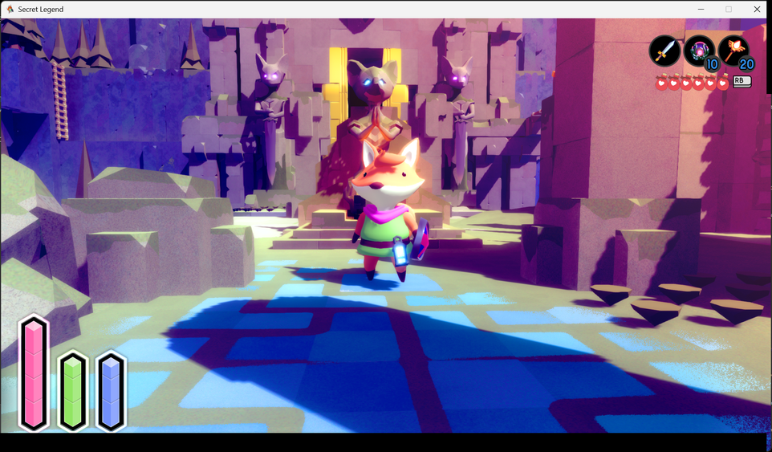

# TUNIC – Camera Modes & 3D

A BepInEx 6 (IL2CPP) mod for *TUNIC* that adds player-controlled camera modes and half side-by-side stereo 3D.



## Features

- **Camera modes:** tap **R3** (or **F5**) to cycle **Default → 3rd Person Orbit → 3rd Person Chase → 1st Person**.
  - **Default:** the game's original camera.
  - **Orbit:** turn the camera freely around the fox with the right stick (or hold the right mouse button and move the mouse).
  - **Chase:** like Orbit, but the camera swings back behind the fox when you stop steering it.
  - **1st Person:** look out from the fox's head.
  - Hold **Focus** with nothing to target and the camera turns to face where the fox faces.
  - Switching modes glides the camera over 1 second, including to and from the game's orthographic view.
  - Cutscenes still use the game's own camera.
- **3D (half SBS):** toggle in **Options → Graphics** or with **F6**. Both eyes are full renders, with all of the game's screen effects. The HUD, menus, the instruction manual, the title screen and the logo screens all appear in both halves.
- **Fixes for the other angles:** level geometry and effects tuned for the fixed default camera are switched off in the custom modes:
  - black fog planes;
  - the see-through-walls silhouette;
  - depth of field.

## Install

1. Install [BepInEx 6 (IL2CPP, x64)](https://builds.bepinex.dev/projects/bepinex_be) into the game folder (next to `Tunic.exe`) and run the game once.
2. Copy `TunicCamera.dll` into `BepInEx\plugins\`.

## Settings

`BepInEx\config\tunic.camera.modes.cfg`

| Section | Setting | Default | |
|---|---|---|---|
| General | `ModeCycle` | Default,Orbit,Chase,FirstPerson | Modes cycled by R3 / `CycleKey`, in order |
| General | `CycleKey` | F5 | |
| General | `TakeOverR3` | true | Remove R3 from the game's Toggle Focus |
| General | `InvertY` | false | |
| General | `StickYawSpeed` / `StickPitchSpeed` | 150 / 100 | Right-stick look speed (°/s) |
| General | `MouseSensitivity` | 3 | Mouse look while holding the right mouse button |
| General | `CameraCollision` | true | Pull the camera in front of walls |
| General | `TransitionTime` | 1 | Seconds the camera glides between modes (0 = instant cut) |
| General | `SmoothPlayerMotion` | true | Smooth the fox's motion in custom modes. Turn this off if the fox misbehaves |
| General | `HideFogPlanes` / `DisableOcclusionMask` / `DisableDepthOfField` | true | Hide default-camera-only effects in custom modes |
| Orbit / Chase | `Distance`, `Pitch`, `Fov` | 10, 35, 50 / 6, 18, 55 | Chase also has `FollowTime` (0.5 s) |
| FirstPerson | `Fov` | 70 | |
| 3D | `Enabled` | false | |
| 3D | `ToggleKey` | F6 | |
| 3D | `Separation` | 0.15 | Eye distance in custom modes (the fox is about 1 unit tall) |
| 3D | `OrthoAngle` | 1.5 | Angle between the eyes (°) for the default camera |

**F9** writes camera and rendering diagnostics to `BepInEx\LogOutput.log`.

## Build

Requires the .NET SDK and BepInEx installed in the game (references come from its `unhollowed` folder). The build copies the DLL into the game's plugins folder.

```
dotnet build -c Release
dotnet build -c Release -p:GameDir="D:\Games\TUNIC"   # if the game isn't in the default Steam folder
```
